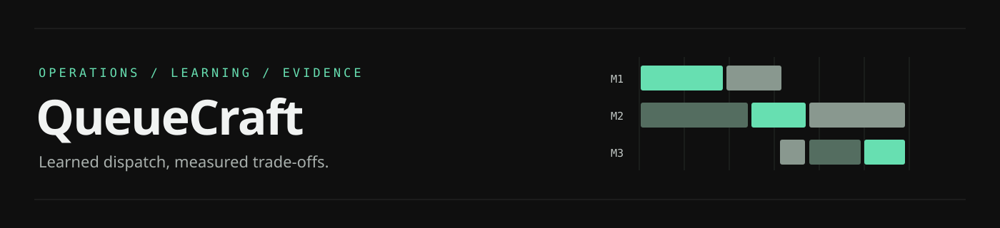
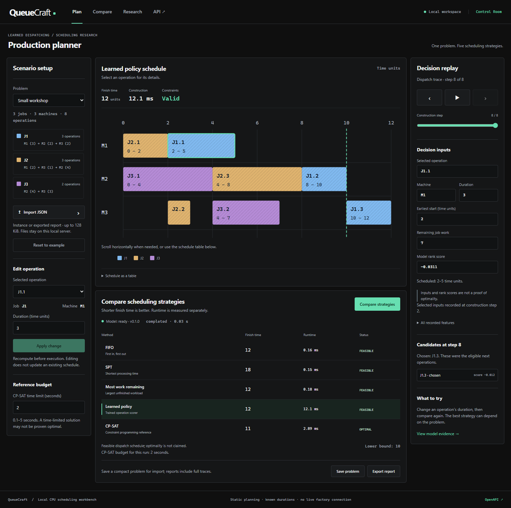

<p align="left"></p>

# QueueCraft

QueueCraft is a local job-shop scheduling workbench. Import jobs, compare three dispatch rules, a trained operation scorer and CP-SAT, then inspect the resulting machine schedule. Change an operation's known duration and compare the revised plan before work starts.

The learned policy is a **trained scikit-learn model**. It ranks eligible operations using 15 features from the problem and partial schedule. The application runs inference locally; importing a problem does not train the model or send it to an external AI API.

## Current evidence

The experiment used **240 training instances, 48 development instances, 72 frozen test instances and 36 larger-size instances**. The selected gradient-boosted regressor learned from 18,242 candidate-action labels. All three candidate fits used training data; configuration selection used development schedules only.

On the 72-instance synthetic test, mean paired makespan reduction was **20.95% against shortest-processing-time** and **10.06% against most-work-remaining**. The results do **not** establish an advantage over FIFO or the per-instance best of the three rules. CP-SAT returned better schedules and lower median calculation time than ML on these small cases.


Read the [full results and confidence intervals](docs/RESULTS.md), [model card](docs/MODEL_CARD.md) and [research sources](docs/RESEARCH.md). These are controlled synthetic results, not measured factory savings.

## Try the workbench



Screenshots: [mobile layout](docs/assets/control-room-mobile.png), [research view](docs/assets/research.png), [API reference](docs/assets/api.png). These show the implemented application; the earlier generated design concepts remain in docs/design/.

Requirements: Python 3.12 and Node.js 24 are the tested versions. A CPU is sufficient; no GPU, cloud account or AI API key is needed. Initial dependency installation needs network access.

On Windows PowerShell, from the repository root:

```powershell
python -m venv .venv
.venv\Scripts\python.exe -m pip install -r requirements.lock.txt
.venv\Scripts\python.exe -m pip install --no-deps -e .
cd web
npm.cmd ci
npm.cmd run build
cd ..
.venv\Scripts\python.exe -m uvicorn queuecraft.api:app --host 127.0.0.1 --port 8774
```

If using an existing project-local uv environment instead of pip, install with `uv pip sync --python .venv\Scripts\python.exe requirements.lock.txt`, then `uv pip install --python .venv\Scripts\python.exe --no-deps -e .`.

Open [the local application](http://127.0.0.1:8774/), [API documentation](http://127.0.0.1:8774/docs) or [research page](http://127.0.0.1:8774/research). The repository includes trained weights and evaluation evidence. Python must remain running for calculation; GitHub Pages cannot run this backend. Swagger UI's standard documentation assets use a CDN; the application and `/openapi.json` do not require that renderer.

1. Choose **Small workshop**, **Shared bottleneck** or **Uneven operations**, or import a JSON problem.
2. Run **Compare strategies** and select a method's result.
3. Select a Gantt operation or a table row. Replay dispatch construction to inspect eligible candidates and input features.
4. Edit a duration. Old results become stale until recalculation.
5. Use **Save problem** for compact JSON that can be imported again, or **Export report** for full schedules, decision traces and model provenance. A full report can exceed the 128 KiB import limit; the compact problem remains the portable input.

Replay speed controls only the visualization. The displayed calculation time comes from the backend. CP-SAT shows a reference schedule, not a learned decision trace. Scores rank candidates; they are not confidence percentages or proof of optimality.

## Input and API

Machine indices in JSON start at zero; the UI displays `M1` for machine `0`. Durations use abstract integer time units. Each job's operation list defines its precedence order.

```json
{
  "name": "Two jobs",
  "machines": 2,
  "jobs": [
    {"id": "A", "operations": [{"machine": 0, "duration": 3}, {"machine": 1, "duration": 2}]},
    {"id": "B", "operations": [{"machine": 1, "duration": 2}, {"machine": 0, "duration": 1}]}
  ]
}
```

Limits: 128 KiB JSON; 1–12 machines; 1–24 jobs; 1–12 operations per job; at most 144 operations; durations 1–1000. Job IDs must be unique, 1–24 alphanumeric/underscore/hyphen characters. Extra fields, repeated object keys, booleans as integers and non-finite values are rejected. The model's training size range is smaller than the API's supported input range; larger imports do not carry a quality guarantee.

| Endpoint | Purpose |
|---|---|
| `GET /api/examples` | Example problems |
| `GET /api/model` | Actual artifact status and evaluation summary |
| `POST /api/runs` | Queue `{instance, strategies, solver_seconds}` |
| `GET /api/runs/{id}` | Poll state and partial method results |
| `DELETE /api/runs/{id}` | Cancel a pending/active run or remove a finished run |
| `GET /api/runs/{id}/export` | Export actual available results |

Strategy IDs: `fifo`, `spt`, `mwkr`, `learned`, `cp_sat`. Solver budget: 0.1–5 seconds. The local service processes one run at a time, allows four active/queued runs and retains at most 16 runs. Finished runs expire after 30 minutes. Restarting the process clears imported jobs; export results to keep them. No imported job enters training.

## Scheduling and learning

Every dispatch strategy uses the same append-only serial schedule generator. Each unfinished job contributes its next operation as an eligible **planning** action, including operations whose earliest feasible execution time lies in the future. The generator schedules a selected operation after both its predecessor and the machine's already scheduled work.

- FIFO chooses the job head with the earliest job-ready time, then the input job order.
- SPT chooses shortest duration, then earliest start and input order.
- Most-work-remaining chooses greatest remaining job work, then earliest start, duration and input order.
- The learned scorer chooses its highest predicted score, then earliest start, duration and input order.
- CP-SAT solves the static constraint model separately with an explicit wall-time budget and one search worker.

These comparisons apply to these precise rule implementations. An independent validator checks operation coverage, identities, duration arithmetic, precedence and machine overlap for each returned schedule. `FEASIBLE` does not mean `OPTIMAL`; a timed-out `UNKNOWN` does not establish infeasibility.

Training first checks that teacher machine ordering can be replayed by this generator. Candidate targets compare full valid completions after forcing each action and finishing using a CP-derived ordering. Multiple equally good actions share a target. Teacher start times and expert costs enter targets only, not input features. Split boundaries group entire problems and equivalent job/machine relabelings before creating decision states.

## Reproduce and verify

The shipped artifact is preserved by default. To reproduce the fixed experiment in a separate local directory:

```powershell
.venv\Scripts\python.exe -m queuecraft.train gate --run-dir work\reproduction-01
.venv\Scripts\python.exe -m queuecraft.train train --run-dir work\reproduction-01
.venv\Scripts\python.exe -m queuecraft.train evaluate --run-dir work\reproduction-01
```

These commands create up to three new fits in that separate directory; they do not activate the new artifact. Re-running training over an existing artifact or overwriting an existing frozen evaluation is refused. Reproduction uses the same fixed data protocol; a new improvement study needs a new protocol and unseen evaluation data.

```powershell
.venv\Scripts\python.exe -m pytest --basetemp work\pytest-local
cd web
npm.cmd test
npm.cmd run build
```

Optional report rendering requires the `report` extra: install `.[report]`, then run `python scripts/render_report.py`. Rendering reads saved evaluation records and never executes the model.

Model loading uses only the fixed project artifact and checks its version/schema/checksum. Joblib is trusted-code loading: use this project's own artifact, not an untrusted downloaded replacement. A checksum alone does not authenticate a model.

## Scope and provenance

QueueCraft currently models known durations, fixed machine assignments and non-preemptive work. It does not model material availability, deadlines, setup time, staff, maintenance, unexpected breakdowns or live factory control. It has not been validated in a factory. The current ML experiment found no solver-speed advantage.

The small example adapts Google's published OR-Tools job-shop example. Other examples and experimental instances are generated locally by this project. The design builds on established learned-dispatch research and scheduling libraries; see [sources](docs/SOURCES.json). Development used AI assistance.
