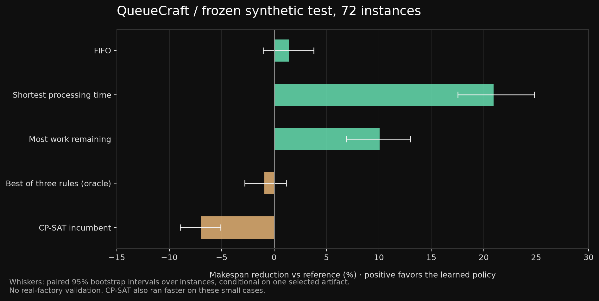

# Measured results

Evidence date: 2026-10-28. The selected artifact uses three CPU-fit configurations and development-only selection. No frozen-test result was used for training or configuration selection.

## Training

- Training instances: 240; development: 48.
- Labels: 18242; features: 15; model fits: 3.
- All 240 training teachers proved optimal within the configured budget and passed serial replay. The earlier 18-case feasibility gate also passed.
- The target is negative normalized forced-action rollout regret. Several equally good candidate actions receive the same target.

## Frozen test: 72 instances

Reduction is the average of `100 * (reference_makespan - learned_makespan) / reference_makespan` over paired instances. Positive values favor ML. It is not a ratio of aggregate mean durations.

| Reference | Mean reduction | Paired 95% interval | ML wins / ties / losses |
|---|---:|---:|---:|
| FIFO | +1.40% | [-1.04%, +3.79%] | 32 / 13 / 27 |
| Shortest processing time | +20.95% | [+17.54%, +24.84%] | 63 / 5 / 4 |
| Most work remaining | +10.06% | [+6.91%, +12.99%] | 53 / 8 / 11 |
| Best of three rules (oracle) | -0.91% | [-2.81%, +1.16%] | 23 / 19 / 30 |
| CP-SAT incumbent | -7.00% | [-8.95%, -5.08%] | 0 / 26 / 46 |

The FIFO and best-of-rules intervals include zero. These results do not establish an advantage over those comparisons. The best-of-rules row chooses the best of the three complete heuristic schedules separately for each problem; it is an oracle comparison, not one deployed rule.

## Runtime and reference coverage

End-to-end method time includes construction/features/prediction and schedule validation. It excludes HTTP, plotting/replay and artifact loading. Teacher generation and training are separate costs.

| Split | Method | Valid schedules | Proven optima | Median method time |
|---|---|---:|---:|---:|
| test | fifo | 72 / 72 | 0 | 0.29 ms |
| test | spt | 72 / 72 | 0 | 0.26 ms |
| test | mwkr | 72 / 72 | 0 | 0.28 ms |
| test | learned | 72 / 72 | 0 | 26.15 ms |
| test | cp_sat | 72 / 72 | 72 | 4.30 ms |
| ood | fifo | 36 / 36 | 0 | 0.77 ms |
| ood | spt | 36 / 36 | 0 | 0.68 ms |
| ood | mwkr | 36 / 36 | 0 | 0.88 ms |
| ood | learned | 36 / 36 | 0 | 56.28 ms |
| ood | cp_sat | 35 / 36 | 35 | 10.83 ms |

CP-SAT produced a better schedule and lower median method time than the learned policy on these small test sets. QueueCraft does not currently demonstrate solver acceleration. Its demonstrated contribution is a reproducible learned-dispatch experiment and an inspectable comparison workbench.

## Larger-size check

The 36 larger instances have seven jobs and six machines, outside the training size range of three to six jobs and three to five machines. They use the same three duration families; this tests size transfer, not an unseen factory or a wholly new noise/process distribution.

| Reference | Mean reduction | ML wins / ties / losses | Paired count |
|---|---:|---:|---:|
| FIFO | +2.46% | 17 / 5 / 14 | 36 |
| Shortest processing time | +35.64% | 36 / 0 / 0 | 36 |
| Most work remaining | +12.56% | 28 / 3 / 5 | 36 |
| Best of three rules (oracle) | +1.86% | 14 / 7 / 15 | 36 |
| CP-SAT incumbent | -9.38% | 0 / 4 / 31 | 35 |

One of the 36 larger CP-SAT solves returned no incumbent within 0.5 seconds. That case is excluded from the paired CP-SAT comparison and remains visible in the saved instance records. UNKNOWN is not INFEASIBLE. Comparisons use returned incumbents; a proof of optimum depends on each recorded solver status.

## Limitations

Synthetic, fully known static instances only. No measured manufacturing savings, deadlines, setup/changeover cost, materials, machine maintenance, unexpected failures or human scheduling validation. The learned policy's worst main-test loss against FIFO is 25.66% longer makespan. A small experimental scorer is not a production-control system.

Bootstrap intervals describe paired-instance sampling conditional on one selected artifact. They do not account for training-seed variation. Candidate configurations use different seeds and hyperparameters; they are not a controlled seed-stability experiment.

## Evidence files

- `artifacts/protocol.json`: splits, budgets, candidates and selection objective, saved before fitting.
- `data/instances.json`: all generated instances and exact relabeling-invariant group IDs.
- `artifacts/training_evidence.json`: label counts and teacher/replay outcomes.
- `artifacts/model.json`, `scorer.joblib`: selected parameters, version, artifact hash and weights.
- `artifacts/evaluation.json`: frozen-test and larger-size per-instance results, runtimes, validation and reference status.

Do not select a new model using these frozen results. A new improvement study needs a fresh evaluation protocol.
